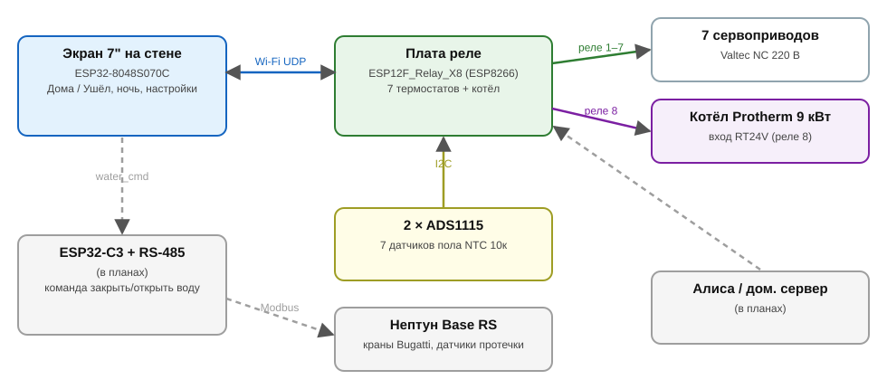

# home_smart — умный тёплый пол своими руками

Самодельное управление водяным тёплым полом в квартире на ESPHome. Без облаков и без подписок. Вместо 7 механических терморегуляторов работают одна плата с реле и сенсорный экран на стене. Следующий этап — управление кранами защиты от протечек «Нептун».



## Что умеет сейчас

- **7 зон тёплого пола:** Балкон, Кухня, Детская, Спальня, Коридор, Ванная, Туалет. Своя температура в каждой комнате.
- **Котёл включается только когда нужен.** Если хотя бы одна зона открыта, через 3 минуты (пока откроются сервоприводы) включается котёл. Когда все зоны закрыты, котёл выключается.
- **Сенсорный экран 7"** с двумя режимами:
  - **Дома** — каждая комната держит свою температуру;
  - **Ушёл** — все комнаты держат 15° и подаётся команда закрыть воду.
- **Ночной режим** (в настройках): время начала и конца, одна ночная температура.
- **Защиты:**
  - обрыв датчика пола → зона закрывается, на экране «нет датчика»;
  - сервоприводы не переключаются чаще раза в 5 минут;
  - если плата сломается, нормально-закрытые приводы закроются, а котёл без сигнала не греет.
- **Память:** настройки и температуры сохраняются, после перезагрузки не сбрасываются.
- **Связь экран ↔ плата** идёт напрямую по Wi-Fi (UDP), без сервера. Задержка 3–5 с.

## Планы

- [ ] Нептун: закрывать и открывать воду с экрана и голосом (ESP32-C3 + RS-485)
- [ ] 2 беспроводных датчика протечки (Tuya, SECUGARD)
- [ ] Алиса / домашний сервер
- [ ] Финальный монтаж: корпус на DIN-рейке, блок питания 12 В

## Документация

| Раздел | Что внутри |
|---|---|
| [docs/hardware.md](docs/hardware.md) | Что купили, что уже стояло, что осталось купить |
| [docs/wiring.md](docs/wiring.md) | Распиновка, датчики, ADS1115, экран |
| [docs/electrician.md](docs/electrician.md) | **Схема для электрика**: 220 В, сервоприводы, котёл, питание |
| [docs/neptun.md](docs/neptun.md) | План подключения Нептуна |
| [docs/flashing.md](docs/flashing.md) | Как прошивать с Windows (в том числе с русским именем пользователя) |
| [docs/history.md](docs/history.md) | Журнал: как делали, какие были ошибки и как их исправили |

## Файлы

| Файл | Что это |
|---|---|
| `teplopol.yaml` | Прошивка платы реле (ESP12F_Relay_X8, ESP8266) |
| `ekran.yaml` | Прошивка экрана (Sunton ESP32-8048S070C) |
| `gen_ekran.py` | Генератор `ekran.yaml`: правки вносятся в него, потом `python gen_ekran.py` |
| `esp.bat` | Забирает свежие файлы с GitHub и прошивает: `esp.bat ekran.yaml` |
| `secrets.example.yaml` | Образец файла с паролями. Сам `secrets.yaml` в GitHub не попадает |

## Быстрый старт

```
cd C:\esphome
git clone https://github.com/Reonimator/home_smart
```
1. Скопируйте `secrets.example.yaml` в `secrets.yaml` и впишите сеть Wi-Fi и пароли.
2. Прошейте: `C:\esphome\home_smart\esp.bat ekran.yaml` или `esp.bat teplopol.yaml`.
