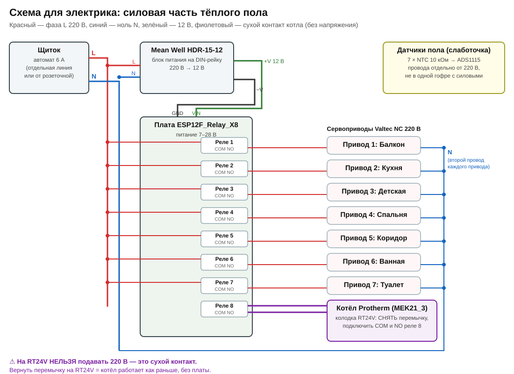

# Схема для электрика

## Коротко

1. **Питание коробки:** от отдельного автомата «управление» в существующем щитке → L и N. Котёл подключён к своему отдельному автомату.
2. **Блок питания Mean Well HDR-15-12** (на DIN-рейку): вход L/N 220 В, выход +V/−V 12 В → на клеммы питания платы (VIN/GND, допускается 7–28 В).
3. **Сервоприводы Valtec** (нормально-закрытые, 220 В, 7 шт.):
   - фаза L подаётся на **COM** реле 1–7;
   - с **NO** реле 1–7 идёт первый провод привода своей комнаты;
   - второй провод каждого привода идёт на **N**.
4. **Котёл Protherm, плата MEK21_3**, колодка `+BUS− | RT24V | LIMITER`:
   - с **RT24V** снять перемычку;
   - на её место подключить **COM и NO реле 8**.
   - ⚠ Это **сухой контакт**: 220 В на него подавать **нельзя**.
5. **Датчики пола** — это слаботочка (3,3 В). Их провода прокладываются отдельно от 220 В. Как подключать, см. [wiring.md](wiring.md).

## Соответствие реле и комнат

| Реле | 1 | 2 | 3 | 4 | 5 | 6 | 7 | 8 |
|---|---|---|---|---|---|---|---|---|
| Что | Балкон | Кухня | Детская | Спальня | Коридор | Ванная | Туалет | Котёл (RT24V) |

Полотенцесушитель (5-й выход коллектора) открыт всегда, на реле не заведён.

## Если что-то пошло не так

- **Плата выключена или сломалась:** нормально-закрытые приводы закрываются, полы остывают. Котёл без сигнала на RT24V не греет. Перегрева не будет.
- **Вернуть всё как было:** поставить перемычку на RT24V. Котёл снова работает по своей логике.

## Монтаж

- Корпус ABS 200×120×75, внутри DIN-рейка.
- Место под коробку: 15 см ширина, 40 см высота, 12 см глубина. Всё оборудование (коллектор, котёл, Нептун) рядом, в пределах 30 см.
