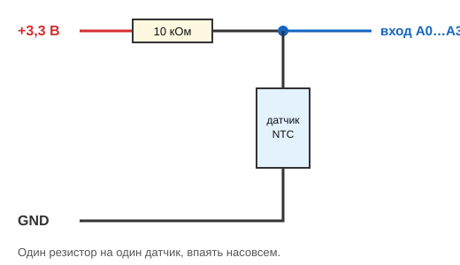

# Подключение (слаботочная часть)

Силовая часть (220 В, котёл) описана в [electrician.md](electrician.md).

## Плата реле ESP12F_Relay_X8 (ESP-07)

| Реле | GPIO | Что подключено | Примечание |
|---|---|---|---|
| 1 | GPIO16 | Балкон | на старте коротко щёлкает |
| 2 | GPIO14 | Кухня | |
| 3 | GPIO12 | Детская | |
| 4 | GPIO13 | Спальня | |
| 5 | GPIO15 | Коридор | |
| 6 | GPIO0 | Ванная | на старте коротко щёлкает |
| 7 | GPIO4 | Туалет | |
| 8 | GPIO5 | **Котёл** (сухой контакт RT24V) | |

Короткие щелчки реле 1 и 6 при включении для тепловых сервоприводов безопасны: они открываются минутами.

Остальные выводы:
- **I2C:** SDA = GPIO2 (IO2), SCL = GPIO3 (RXD). Поэтому лог в UART выключен (`baud_rate: 0`). Перед прошивкой кабелем провод SCL от RXD нужно отсоединить.
- **Режим флеша:** `dout`, 1 МБ.
- **Прошивка:** CP2102 → TX/RX/GND, GPIO0 на GND при включении.

## Датчики пола: ADS1115 + делитель

Два модуля ADS1115 питаются от **3,3 В**. Провод для питания впаян в вывод стабилизатора AMS1117 (U2) на плате реле.

| Модуль | ADDR | Адрес | A0 | A1 | A2 | A3 |
|---|---|---|---|---|---|---|
| ADS #1 | → GND | 0x48 | Балкон | Кухня | Детская | Спальня |
| ADS #2 | → VDD | 0x49 | Коридор | Ванная | Туалет | — |



Для каждого датчика нужен **один** резистор 10 кОм. Второе плечо делителя — сам датчик.

```
+3.3V ──[резистор 10к]──┬── вход ADS (A0…A3)
                        │
                    [датчик NTC]
                        │
GND ────────────────────┘
```

- Резистор нужно впаять **насовсем**. Без него вход «висит», плата видит ложную температуру (например 22,4°) и может зря включить котёл.
- В прошивке: `resistance` с `UPSTREAM` 10 кОм, `ntc` с калибровкой по 3 точкам из паспорта Valtec VT.AC602 (5° → 22 070 Ом, 20° → 12 091 Ом, 40° → 5 827 Ом), сглаживание по 3 замерам.
- `reference_voltage` — реальное напряжение на VDD модулей ADS1115. Его стоит измерить мультиметром и вписать: ошибка в 50 мВ сдвигает показания примерно на 0,5°.
- На веб-странице платы видно сопротивление каждого датчика (строки «Зона 1 Балкон» и т. д.: температура | Ом | цель | реле). Перевод в температуру по паспорту: 12 091 Ом = 20°, 11 200 = 22°, 10 383 = 24°, 9 633 = 26°, 8 945 = 28°, 8 313 = 30°. Если мультиметр на концах кабеля показывает другое, проблема в коробке; если то же самое — в кабеле или скрутке.
- Длина кабеля датчика на точность почти не влияет: 30 м дают ошибку около 0,004°. Паспорт допускает удлинение до 50 м.
- Значения ниже 5° и выше 45° считаются обрывом или замыканием. Тогда зона закрывается, а на экране пишется «нет датчика».

## Экран Sunton ESP32-8048S070C

- Питание: USB-C 5 В, от обычной зарядки.
- Дисплей RGB: de 41, hsync 39, vsync 40, pclk 42 (14 МГц, инверсия).
  - R: 14, 21, 47, 48, 45
  - G: 9, 46, 3, 8, 16, 1
  - B: 15, 7, 6, 5, 4
- Тач GT911: SDA 19, SCL 20. Подсветка: GPIO2 (ШИМ 20 кГц).
- Прошивка по USB-C (на ноутбуке это порт COM5).

## Связь экран ↔ плата

Связь идёт по ESPHome `packet_transport` через UDP. Это широковещательные пакеты в домашней сети, сервер не нужен.

| Откуда → куда | Что передаётся |
|---|---|
| Плата → экран | `t1…t7` (температуры пола), `h1…h7` (зона греет), `h8` (котёл) |
| Экран → плата | `set1…set7` (целевые температуры с учётом режима), `water_cmd` (1 = закрыть воду) |

Изменения с экрана отправляются сразу, полный обмен идёт раз в секунду, поэтому реакция занимает около 1 секунды.

Защита сервоприводов: зона греет минимум 5 минут после включения и после выключения ждёт минимум 5 минут перед новым включением.
